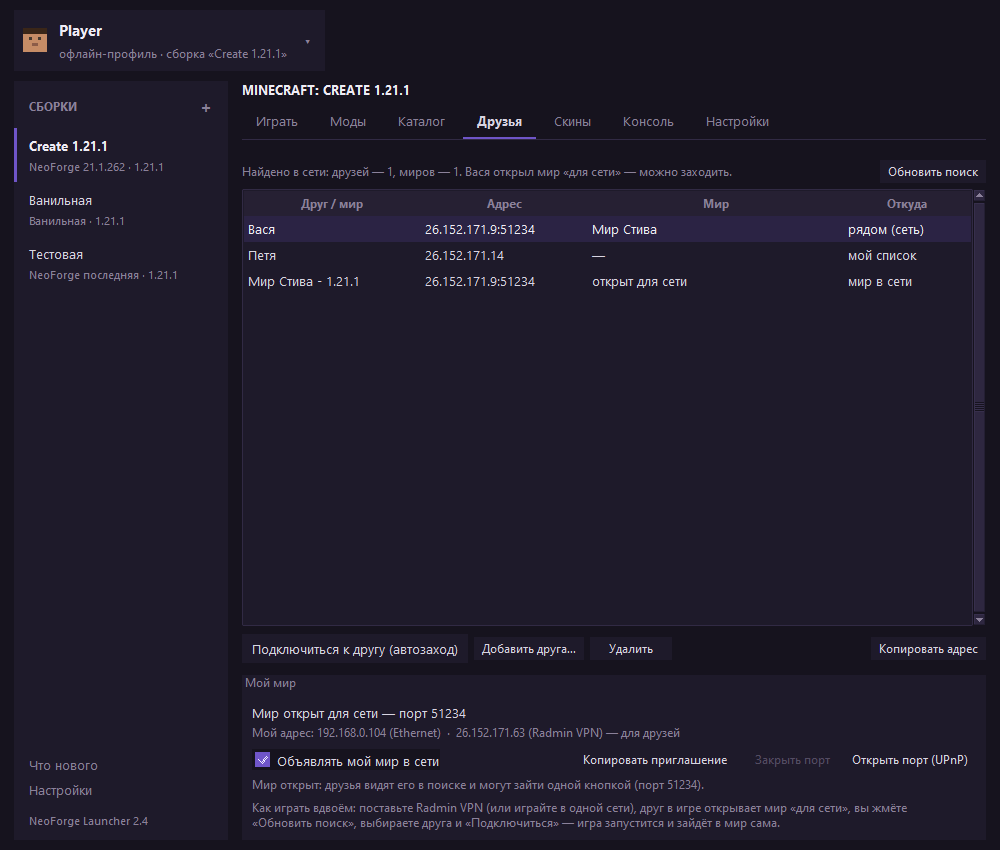

# NeoForge Launcher — Minecraft 1.21.1

Лаунчер для **Minecraft 1.21.1 + NeoForge** на Python (tkinter), без сторонних библиотек.
Сам скачивает игру, NeoForge и Java 21, управляет модами, умеет ставить скины офлайн,
качать моды/датапаки/ресурспаки из каталога Modrinth и играть с друзьями без сервера —
по локальной сети или через Radmin VPN.


Окно собрано **в духе официального лаунчера Minecraft**: сверху строка аккаунта, слева — список
сборок, по центру — название сборки, вкладки и баннер с большой кнопкой **ИГРАТЬ**. Вместо
изданий (Bedrock/Java/Dungeons) в списке слева — **сборки**: у каждой свой режим (NeoForge или
ваниль), версия, объём ОЗУ и папка игры, переключение одним кликом.

Оформление — **тёмная тема**: приглушённые цвета, один акцентный **фиолетовый**, плоские вкладки
и таблицы без рамок. Заголовок окна рисует сама Windows: в Windows 10 он остаётся светлым,
в Windows 11 лаунчер просит для него тёмный вид.

## Что умеет

| Возможность | Детали |
|---|---|
| Тёмный интерфейс | тёмная тема с приглушённым фиолетовым акцентом, плоские вкладки, свои галочки и радиокнопки, тёмные таблицы и поля ввода |
| **Сборки** | список слева: имя + режим, версия Minecraft, версия NeoForge, ОЗУ и папка игры. Переключение одним кликом, «ИГРАТЬ» запускает выбранную; сборки можно копировать, переименовывать и удалять |
| Установка Minecraft 1.21.1 | клиент, все библиотеки, индекс и объекты ассетов (~830 МБ), конфиг логирования |
| Установка NeoForge | реальный установщик NeoForge + проверка/докачка всех его библиотек |
| Авто-скачивание Java 21 | Temurin JRE с Adoptium, если подходящей Java в системе нет |
| **Каталог контента** | поиск и установка модов, датапаков и ресурспаков с Modrinth; фильтр «только Create» включён по умолчанию; кнопка «Установить Create» одним нажатием (зависимости подтягиваются автоматически) |
| **Система скинов** | скин по нику (Мойанг), из файла или по ссылке; превью персонажа; применение к игре **без модов** через ресурспак |
| **Друзья и игра по сети** | поиск миров, открытых «для сети», в локальной сети и Radmin VPN; автозаход в мир друга одной кнопкой; приглашения кодом `CL1.…`; проброс порта через UPnP — если роутер умеет |
| **Ярлык** | кнопка «Создать ярлык на рабочем столе» (или `--cli shortcut`) — ярлык запускает окно без консоли, со своей иконкой |
| Менеджер модов | список папки `mods`, включение/выключение (`.disabled`), добавление, удаление, открыть папку |
| Настройки | сборка, ник, папка игры, объём ОЗУ, своя Java, доп. аргументы JVM, «закрывать лаунчер после запуска» |
| Консоль игры | весь вывод Minecraft прямо в окне лаунчера, с автопрокруткой |
| Смена ника | ник меняется кликом по строке аккаунта сверху (или в «Настройках») и сразу идёт в скин и профиль запуска |
| Офлайн-вход | ник → офлайн-UUID (как в других неофициальных лаунчерах) |
| Режим без NeoForge | можно запустить чистую 1.21.1 — это отдельная сборка |





Ещё снимки: [моды](docs/tab-mods.png), [консоль](docs/tab-console.png),
[настройки](docs/tab-settings.png).

## Требования

* Windows (проверено) / Linux / macOS
* Python 3.9+ (tkinter входит в стандартный установщик Python для Windows)
* ~2 ГБ свободного места (игра ~1,2 ГБ; звуки ~700 МБ, их можно не качать)
* Java устанавливать **не нужно** — лаунчер возьмёт Java 21 из официального лаунчера Minecraft,
  если он установлен, а иначе скачает Temurin 21 сам

## Запуск

1. Двойной клик по `run.bat`, по ярлыку **NeoForge Launcher**, или `python launcher.py`.
2. Ник — кликом по строке аккаунта сверху; сборка — в списке слева или в «Настройках».
3. Нажать **ИГРАТЬ** — лаунчер сам всё скачает.
4. Первый запуск долгий (скачивание ~1 ГБ). Следующие — секунды.

Чтобы не качать 700 МБ звука: **Настройки → Не скачивать звуки**. Игра запустится
полностью рабочей, но без звука.

### Папка игры

По умолчанию `<папка лаунчера>/.minecraft`. Изменить можно в лаунчере или в `config.json`.
Моды — в `<папка игры>/mods`.

## Сборки

Сборка — это набор настроек запуска: **режим** (NeoForge или ваниль), **версия Minecraft**,
**версия NeoForge**, **объём ОЗУ**, **папка игры** и **доп. аргументы JVM**. Ник, Java,
звуки и остальные переключатели — общие для лаунчера.

* список сборок — слева в окне; активная помечена фиолетовой полосой;
* **«+»** — новая сборка (копия текущих настроек), **правый клик** — изменить, дублировать,
  удалить; последнюю сборку удалить нельзя;
* **«Изменить сборку…»** на вкладке «Играть» (и в «Настройках») открывает карточку сборки:
  имя, режим, версии, ОЗУ, папка игры, аргументы JVM;
* в «Настройках» есть выпадающий список сборок — то же переключение, что и слева;
* папка игры у сборок может быть разной: например, «Create 1.21.1» в своей папке со своими
  модами, а «Ванильная» — в отдельной чистой. (Общий список модов у сборок пока один —
  моды лежат в папке игры.)

Всё это лежит в `config.json` в полях `builds` и `current_build`; если списка нет, лаунчер сам
заведёт сборку «Основная» из текущих настроек.

## Каталог: моды, датапаки, ресурспаки

Вкладка **Каталог** ищет по [Modrinth](https://modrinth.com) среди версий для 1.21.1:

* **Моды** — фильтр по загрузчику NeoForge; обязательные зависимости ставятся вместе с модом;
* **Датапаки** — кладутся в `saves/<выбранный мир>/datapacks` (мир выбирается в списке);
* **Ресурспаки** — кладутся в `resourcepacks` и сразу включаются в `options.txt`.

Галочка **«Только контент для Create»** включена по умолчанию: поиск ищет среди Create и
аддонов к нему (Create, Copycats+, Aeronautics, Big Cannons, Deco и т.п.). Снимите её, чтобы
искать любые моды. Кнопка **«Установить Create»** ставит сам Create (Flywheel приезжает вместе
с ним, как встроенная зависимость).

## Скины

Скин можно взять тремя способами: **по нику** (только для лицензионного ника — запрос к
Мойангу), **из PNG-файла** (64×64, обычный формат Minecraft) или **по ссылке**.

Как лаунчер применяет скин **без модов**: он собирает ресурспак `resourcepacks/skin-<ник>.zip`,
который подменяет стандартные текстуры игрока (`entity/player/wide|slim/steve|alex.png`), и
включает его в `options.txt` вместе со слоями скина (`modelPart_hat` и т.д.). В офлайн-режиме
клиент как раз берёт эти стандартные текстуры — поэтому скин виден в одиночной игре и на
серверах без лицензии. Перезапустите игру после применения.

Модель рук можно выбрать: **широкие** (Steve) или **тонкие** (Alex) — от неё зависит ширина
рук у персонажа.

## Друзья и игра по сети

Вкладка **Друзья** — для игры вдвоём без отдельного сервера: Minecraft умеет открывать обычный
одиночный мир «для сети», этого достаточно.

**Как играть**

1. **Оба ставите Radmin VPN** (или играете в одной домашней сети). Radmin создаёт виртуальную
   сеть — компьютеры видят друг друга, как в одной локальной.
2. **Друг-хозяин** запускает игру из лаунчера, заходит в мир и нажимает в игре
   `Esc → Открыть для сети`. Игра напишет порт (например, «Started serving on 51234») —
   лаунчер читает лог сам и начинает объявлять мир в сети.
3. **Вы** открываете вкладку **Друзья** и нажимаете **«Обновить поиск»**: в списке появится
   мир друга, а если у друга запущен лаунчер — то и он сам, по нику.
4. Выбираете строку и жмёте **«Подключиться к другу (автозаход)»**: лаунчер проверяет, что мир
   отвечает, записывает адрес в список серверов игры и запускает Minecraft сразу с заходом
   в мир — штатным ключом 1.21.1 `--quickPlayMultiplayer`. Вручную искать порт и вводить
   адрес в игре не нужно.

Приглашение можно передать сообщением: **«Копировать приглашение»** (или `--cli invite --port 51234`)
кладёт в буфер адрес и код `CL1.…`; получатель вставляет его в **«Добавить друга…»**. Можно и
просто написать строку вида `Вася 26.0.0.5:51234` — лаунчер поймёт.

**Свой мир наружу.** Если роутер поддерживает UPnP, кнопка **«Открыть порт (UPnP)»** пробросит
порт мира и покажет внешний адрес — тогда друг сможет зайти даже без Radmin VPN. Если роутер
UPnP не отдаёт (частая история), лаунчер честно об этом скажет — играйте через Radmin VPN.
Проброшенный порт снимается кнопкой «Закрыть порт» или сам, когда мир закрывается.

**Стоит знать**

* Мир живёт, пока друг в игре и не закрыл его для сети. Если мир не отвечает, лаунчер скажет
  об этом до запуска игры, а не покажет непонятную ошибку.
* Версии и моды должны совпадать: у обоих Minecraft 1.21.1 и одинаковый набор модов —
  иначе NeoForge не пустит в мир.
* Нужен только офлайн-ник: вход в свой мир лицензию не проверяет.
* Лаунчер не поднимает VPN сам (это невозможно без драйвера уровня ядра): он находит адреса
  и объявляет мир, а виртуальную сеть создаёт Radmin VPN.

## Ярлык

Настройки → **Создать ярлык на рабочем столе** (или в папке лаунчера). Ярлык запускает
`pythonw.exe`, поэтому окно консоли не открывается. Иконка лаунчера (`assets/launcher.ico`)
рисуется кодом — это пиксельный крипер.

## Консольные команды

```bat
python launcher.py --cli java                          :: какие Java нашлись
python launcher.py --cli versions                      :: все версии NeoForge для 1.21.1
python launcher.py --cli setup --game-dir D:\mc        :: скачать и установить
python launcher.py --cli launch --game-dir D:\mc       :: установить (если надо) и запустить
python launcher.py --cli check  --game-dir D:\mc       :: проверить classpath и показать команду
python launcher.py --cli content --query create        :: поиск в каталоге
python launcher.py --cli content --install create      :: установить мод по slug
python launcher.py --cli content --type resourcepack --install faithful
python launcher.py --cli skin --skin C:\my_skin.png    :: применить скин
python launcher.py --cli skin                          :: скин по нику (--username)
python launcher.py --cli shortcut                      :: создать ярлыки
python launcher.py --cli lan --timeout 3               :: мои адреса + поиск миров «для сети»
python launcher.py --cli friends                       :: список друзей
python launcher.py --cli friends --add "Вася 26.0.0.5:51234"
python launcher.py --cli friends --check               :: отвечают ли адреса друзей
python launcher.py --cli friends --remove Вася
python launcher.py --cli invite  --port 51234          :: текст приглашения со своим адресом
python launcher.py --cli join    --addr 26.0.0.5:51234 :: автозаход в мир друга
python launcher.py --cli upnp                          :: есть ли роутер с UPnP
python launcher.py --cli upnp --world-port 51234       :: открыть порт мира на роутере
```

Дополнительно: `--mode vanilla`, `--neo 21.1.262`, `--username Nick`, `--ram 6144`,
`--java C:\path\to\java.exe`, `--skip-sounds`, `--type mod|datapack|resourcepack`, `--all`,
`--world <мир>`, `--skin-url <ссылка>`, `--addr <host:port>`, `--port <порт>`,
`--world-port <порт>`, `--add "Имя адрес"`, `--remove Имя`, `--check`, `--timeout <секунд>`.

## Как это работает внутри

Лаунчер не костыль вокруг «чужого» профиля, а честная реализация того, что делает
официальный лаунчер:

1. **Манифест Mojang** → JSON версии 1.21.1 → клиент, библиотеки, ассеты, конфиг log4j2.
2. **Слияние версий** (`inheritsFrom`): профиль NeoForge склеивается с 1.21.1 —
   библиотеки объединяются (дочерние переопределяют родительские), аргументы JVM и игры
   конкатенируются, `mainClass` берётся у NeoForge (`cpw.mods.bootstraplauncher.BootstrapLauncher`).
3. **Установщик NeoForge** запускается с `--installClient`. Ему обязателен
   `launcher_profiles.json`, поэтому лаунчер его создаёт.
4. **Классы игры.** Установщик создаёт патченый клиент
   (`libraries/net/neoforged/neoforge/<ver>/neoforge-<ver>-client.jar`) и NeoForm-артефакты
   (`net.minecraft:client:<mc>-<neoform>:srg` и `:extra`). Класть их в `-cp` **не нужно**:
   NeoForge сам находит их через `LibraryFinder` по `-DlibraryDirectory`. Именно поэтому
   в classpath идут только библиотеки, а jar ванильного клиента кладётся в каталог профиля
   (`versions/neoforge-<ver>/neoforge-<ver>.jar`) и попадает под `-DignoreList`.
5. **Правила и подстановки.** Полностью поддержаны `rules` (os/arch/features) и переменные
   `${classpath}`, `${library_directory}`, `${natives_directory}`, `${version_name}`, быстрые
   запуски и т.д.
6. **Нативные библиотеки** (LWJGL) распаковываются в `natives/<версия>` и добавляются
   в `java.library.path`.
7. **Офлайн-профиль**: UUID = `UUID.nameUUIDFromBytes("OfflinePlayer:" + ник)`, как в Java.
8. **Скины** — ресурспак с подменой стандартных текстур игрока (мод не нужен).
9. **PNG** читается и пишется своим мини-кодеком (`core/png.py` на zlib) — чтобы собирать
   превью скина и иконку без внешних библиотек.
10. **Сеть для друзей** — как в самой игре: слушаются порты 4445 (мультикаст `224.0.2.60`,
    объявления миров, открытых «для сети») и 4446 (свой мультикаст `239.255.42.99` —
    объявления лаунчеров, чтобы друга было видно ещё до захода в игру). Свои пакеты
    отбрасываются, а хостом считается адрес отправителя — ровно как делает клиент игры.
    Автозаход — штатный ключ 1.21.1 `--quickPlayMultiplayer` (фича `is_quick_play_multiplayer`
    плюс переменная `quickPlayMultiplayer`). Список серверов игры (`servers.dat`) — обычный NBT
    **без gzip** (в 1.21.1 файл несжатый), иконка сервера — чистый base64 PNG 64×64.

## Ограничения

* Вход только офлайн-профиль. Для онлайн-серверов с проверкой лицензии нужен аккаунт
  Microsoft (можно добавить: `msa`-флоу + `clientId` Azure).
* Моды должны быть под **NeoForge 1.21.1** — моды от старого Forge (1.21.1-47.x) не подойдут.
* Скины работают офлайн: на лицензионных серверах показывается скин из профиля сервера.
* Игра с друзьями идёт через сеть, которая уже есть в системе (Radmin VPN, домашний Wi-Fi).
  Свой VPN-адаптер лаунчер не создаёт — для этого нужен драйвер уровня ядра. Проброс порта
  через UPnP работает, только если роутер его отдаёт: при «сером» внешнем адресе (CGNAT — так
  у большинства домашних тарифов) прямой вход снаружи не выйдет даже с пробросом, выручает
  Radmin VPN.
* Загрузка ассетов идёт в 8 потоков; прогресс считается по байтам.

## Структура

```
launcher.py            точка входа (GUI и --cli)
run.bat                запуск двойным кликом
core/
  paths.py             пути, разрядность, объём ОЗУ
  config.py            config.json
  down.py              параллельный загрузчик (SHA-1, повторы, прогресс, отмена)
  maven.py             maven-координаты → пути
  rule.py              rules (os/features) и подстановка ${...}
  mojang.py            манифест, установка ванильной версии
  version.py           слияние версий, classpath, нативы
  neoforge.py          версии NeoForge, установщик, проверка профиля
  javas.py             поиск Java и загрузка Temurin
  auth.py              офлайн-UUID, проверка ника
  mods.py              папка mods
  install.py           оркестрация установки
  launch.py            сборка команды и старт процесса
  png.py               мини-кодек PNG (чтение/запись/масштаб/наложение)
  skins.py             скины: скачивание, превью, ресурспак
  modrinth.py          каталог Modrinth: поиск, версии, установка
  nbt.py               NBT-кодек (сжатый и несжатый) для servers.dat
  servers_dat.py       список серверов игры: чтение, добавление, удаление
  lan.py               адреса, поиск миров «для сети», объявления, проверка порта
  friends.py           friends.json, приглашения и коды CL1.…
  upnp.py              проброс порта на роутере (SSDP + SOAP)
  options.py           options.txt (ресурспаки, слои скина)
  branding.py          иконка и логотип (пиксельный крипер)
  hero.py              баннер вкладки «Играть» (пиксельный пейзаж, рисуется кодом)
  shortcut.py          ярлыки Windows/Linux
ui/
  app.py               окно tkinter (аккаунт, сборки, играть, моды, каталог, друзья, скины, консоль)
  theme.py             тёмная тема: палитра, ttk-стили, свои галочки и радиокнопки
tests/smoke.py         быстрые проверки без сети
tools/screenshot.py    снимок окна (для README и проверки вёрстки)
```
