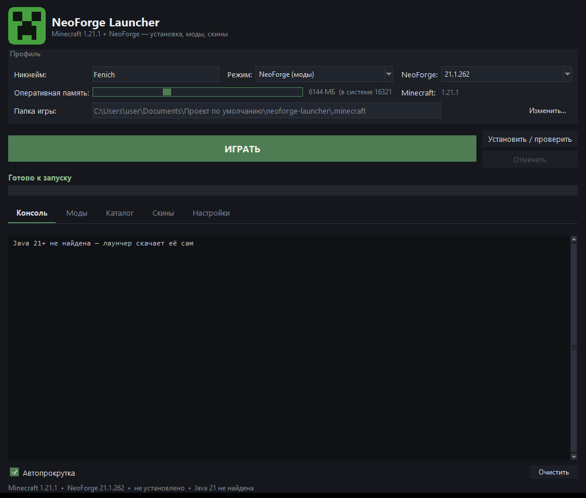
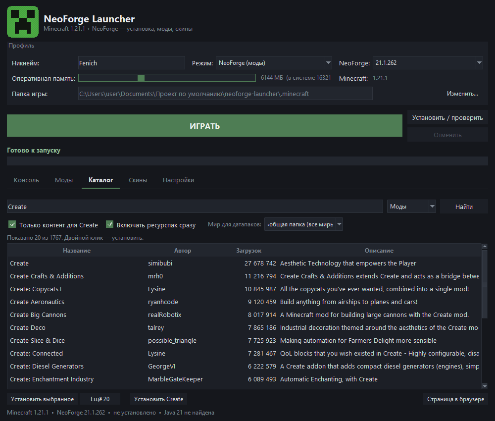
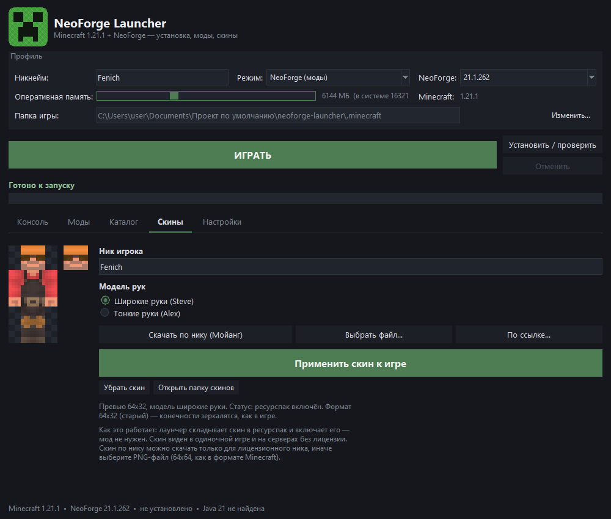

# NeoForge Launcher — Minecraft 1.21.1

Лаунчер для **Minecraft 1.21.1 + NeoForge** на Python (tkinter), без сторонних библиотек.
Сам скачивает игру, NeoForge и Java 21, управляет модами, умеет ставить скины офлайн и
качать моды/датапаки/ресурспаки прямо из каталога Modrinth.



Оформление — **тёмная тема**: приглушённые цвета, один акцентный зелёный, плоские вкладки
и таблицы без рамок. Заголовок окна рисует сама Windows: в Windows 10 он остаётся светлым,
в Windows 11 лаунчер просит для него тёмный вид.

## Что умеет

| Возможность | Детали |
|---|---|
| Тёмный интерфейс | тёмная тема с приглушённым акцентом, плоские вкладки, свои галочки и радиокнопки, тёмные таблицы и поля ввода |
| Установка Minecraft 1.21.1 | клиент, все библиотеки, индекс и объекты ассетов (~830 МБ), конфиг логирования |
| Установка NeoForge | реальный установщик NeoForge + проверка/докачка всех его библиотек |
| Авто-скачивание Java 21 | Temurin JRE с Adoptium, если подходящей Java в системе нет |
| **Каталог контента** | поиск и установка модов, датапаков и ресурспаков с Modrinth; фильтр «только Create» включён по умолчанию; кнопка «Установить Create» одним нажатием (зависимости подтягиваются автоматически) |
| **Система скинов** | скин по нику (Мойанг), из файла или по ссылке; превью персонажа; применение к игре **без модов** через ресурспак |
| **Ярлык** | кнопка «Создать ярлык на рабочем столе» (или `--cli shortcut`) — ярлык запускает окно без консоли, со своей иконкой |
| Менеджер модов | список папки `mods`, включение/выключение (`.disabled`), добавление, удаление, открыть папку |
| Настройки | папка игры, объём ОЗУ, своя Java, доп. аргументы JVM, «закрывать лаунчер после запуска» |
| Консоль игры | весь вывод Minecraft прямо в окне лаунчера, с автопрокруткой |
| Смена ника | ник задаётся в шапке профиля и сразу используется в скине и профиле запуска |
| Офлайн-вход | ник → офлайн-UUID (как в других неофициальных лаунчерах) |
| Режим без NeoForge | можно запустить чистую 1.21.1 |




Ещё снимки: [моды](docs/tab-mods.png), [настройки](docs/tab-settings.png).

## Требования

* Windows (проверено) / Linux / macOS
* Python 3.9+ (tkinter входит в стандартный установщик Python для Windows)
* ~2 ГБ свободного места (игра ~1,2 ГБ; звуки ~700 МБ, их можно не качать)
* Java устанавливать **не нужно** — лаунчер скачает Temurin 21 сам

## Запуск

1. Двойной клик по `run.bat`, по ярлыку **NeoForge Launcher**, или `python launcher.py`.
2. Ввести ник, выбрать версию NeoForge, нажать **ИГРАТЬ** — лаунчер сам всё скачает.
3. Первый запуск долгий (скачивание ~1 ГБ). Следующие — секунды.

Чтобы не качать 700 МБ звука: **Настройки → Не скачивать звуки**. Игра запустится
полностью рабочей, но без звука.

### Папка игры

По умолчанию `<папка лаунчера>/.minecraft`. Изменить можно в лаунчере или в `config.json`.
Моды — в `<папка игры>/mods`.

## Каталог: моды, датапаки, ресурспаки

Вкладка **Каталог** ищет по [Modrinth](https://modrinth.com) среди версий для 1.21.1:

* **Моды** — фильтр по загрузчику NeoForge; обязательные зависимости ставятся вместе с модом;
* **Датапаки** — кладутся в `saves/<выбранный мир>/datapacks` (мир выбирается в списке);
* **Ресурспаки** — кладутся в `resourcepacks` и сразу включаются в `options.txt`.

Галочка **«Только контент для Create»** включена по умолчанию: поиск ищет среди Create и
аддонов к нему (Create, Copycats+, Aeronautics, Big Cannons, Deco и т.п.). Снимите её, чтобы
искать любые моды. Кнопка **«Установить Create»** ставит сам Create (Flywheel приезжает вместе
с ним, как встроенная зависимость).

## Скины

Скин можно взять тремя способами: **по нику** (только для лицензионного ника — запрос к
Мойангу), **из PNG-файла** (64×64, обычный формат Minecraft) или **по ссылке**.

Как лаунчер применяет скин **без модов**: он собирает ресурспак `resourcepacks/skin-<ник>.zip`,
который подменяет стандартные текстуры игрока (`entity/player/wide|slim/steve|alex.png`), и
включает его в `options.txt` вместе со слоями скина (`modelPart_hat` и т.д.). В офлайн-режиме
клиент как раз берёт эти стандартные текстуры — поэтому скин виден в одиночной игре и на
серверах без лицензии. Перезапустите игру после применения.

Модель рук можно выбрать: **широкие** (Steve) или **тонкие** (Alex) — от неё зависит ширина
рук у персонажа.

## Ярлык

Настройки → **Создать ярлык на рабочем столе** (или в папке лаунчера). Ярлык запускает
`pythonw.exe`, поэтому окно консоли не открывается. Иконка лаунчера (`assets/launcher.ico`)
рисуется кодом — это пиксельный крипер.

## Консольные команды

```bat
python launcher.py --cli java                          :: какие Java нашлись
python launcher.py --cli versions                      :: все версии NeoForge для 1.21.1
python launcher.py --cli setup --game-dir D:\mc        :: скачать и установить
python launcher.py --cli launch --game-dir D:\mc       :: установить (если надо) и запустить
python launcher.py --cli check  --game-dir D:\mc       :: проверить classpath и показать команду
python launcher.py --cli content --query create        :: поиск в каталоге
python launcher.py --cli content --install create      :: установить мод по slug
python launcher.py --cli content --type resourcepack --install faithful
python launcher.py --cli skin --skin C:\my_skin.png    :: применить скин
python launcher.py --cli skin                          :: скин по нику (--username)
python launcher.py --cli shortcut                      :: создать ярлыки
```

Дополнительно: `--mode vanilla`, `--neo 21.1.262`, `--username Nick`, `--ram 6144`,
`--java C:\path\to\java.exe`, `--skip-sounds`, `--type mod|datapack|resourcepack`, `--all`,
`--world <мир>`, `--skin-url <ссылка>`.

## Как это работает внутри

Лаунчер не костыль вокруг «чужого» профиля, а честная реализация того, что делает
официальный лаунчер:

1. **Манифест Mojang** → JSON версии 1.21.1 → клиент, библиотеки, ассеты, конфиг log4j2.
2. **Слияние версий** (`inheritsFrom`): профиль NeoForge склеивается с 1.21.1 —
   библиотеки объединяются (дочерние переопределяют родительские), аргументы JVM и игры
   конкатенируются, `mainClass` берётся у NeoForge (`cpw.mods.bootstraplauncher.BootstrapLauncher`).
3. **Установщик NeoForge** запускается с `--installClient`. Ему обязателен
   `launcher_profiles.json`, поэтому лаунчер его создаёт.
4. **Классы игры.** Установщик создаёт патченый клиент
   (`libraries/net/neoforged/neoforge/<ver>/neoforge-<ver>-client.jar`) и NeoForm-артефакты
   (`net.minecraft:client:<mc>-<neoform>:srg` и `:extra`). Класть их в `-cp` **не нужно**:
   NeoForge сам находит их через `LibraryFinder` по `-DlibraryDirectory`. Именно поэтому
   в classpath идут только библиотеки, а jar ванильного клиента кладётся в каталог профиля
   (`versions/neoforge-<ver>/neoforge-<ver>.jar`) и попадает под `-DignoreList`.
5. **Правила и подстановки.** Полностью поддержаны `rules` (os/arch/features) и переменные
   `${classpath}`, `${library_directory}`, `${natives_directory}`, `${version_name}`, быстрые
   запуски и т.д.
6. **Нативные библиотеки** (LWJGL) распаковываются в `natives/<версия>` и добавляются
   в `java.library.path`.
7. **Офлайн-профиль**: UUID = `UUID.nameUUIDFromBytes("OfflinePlayer:" + ник)`, как в Java.
8. **Скины** — ресурспак с подменой стандартных текстур игрока (мод не нужен).
9. **PNG** читается и пишется своим мини-кодеком (`core/png.py` на zlib) — чтобы собирать
   превью скина и иконку без внешних библиотек.

## Ограничения

* Вход только офлайн-профиль. Для онлайн-серверов с проверкой лицензии нужен аккаунт
  Microsoft (можно добавить: `msa`-флоу + `clientId` Azure).
* Моды должны быть под **NeoForge 1.21.1** — моды от старого Forge (1.21.1-47.x) не подойдут.
* Скины работают офлайн: на лицензионных серверах показывается скин из профиля сервера.
* Загрузка ассетов идёт в 8 потоков; прогресс считается по байтам.

## Структура

```
launcher.py            точка входа (GUI и --cli)
run.bat                запуск двойным кликом
core/
  paths.py             пути, разрядность, объём ОЗУ
  config.py            config.json
  down.py              параллельный загрузчик (SHA-1, повторы, прогресс, отмена)
  maven.py             maven-координаты → пути
  rule.py              rules (os/features) и подстановка ${...}
  mojang.py            манифест, установка ванильной версии
  version.py           слияние версий, classpath, нативы
  neoforge.py          версии NeoForge, установщик, проверка профиля
  javas.py             поиск Java и загрузка Temurin
  auth.py              офлайн-UUID, проверка ника
  mods.py              папка mods
  install.py           оркестрация установки
  launch.py            сборка команды и старт процесса
  png.py               мини-кодек PNG (чтение/запись/масштаб/наложение)
  skins.py             скины: скачивание, превью, ресурспак
  modrinth.py          каталог Modrinth: поиск, версии, установка
  options.py           options.txt (ресурспаки, слои скина)
  branding.py          иконка и логотип (пиксельный крипер)
  shortcut.py          ярлыки Windows/Linux
ui/
  app.py               окно tkinter (профиль, моды, каталог, скины, настройки)
  theme.py             тёмная тема: палитра, ttk-стили, свои галочки и радиокнопки
tests/smoke.py         быстрые проверки без сети
tools/screenshot.py    снимок окна (для README и проверки вёрстки)
```
